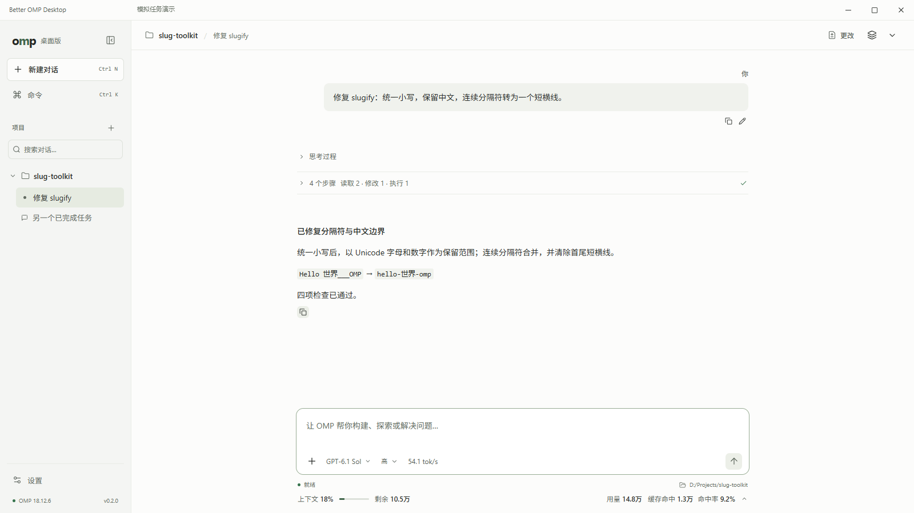
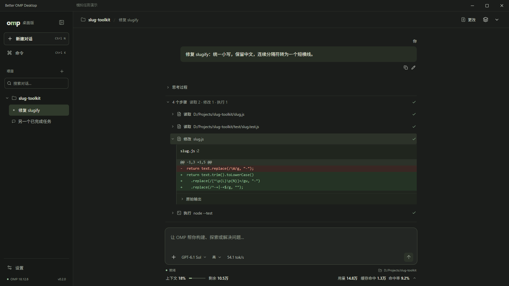
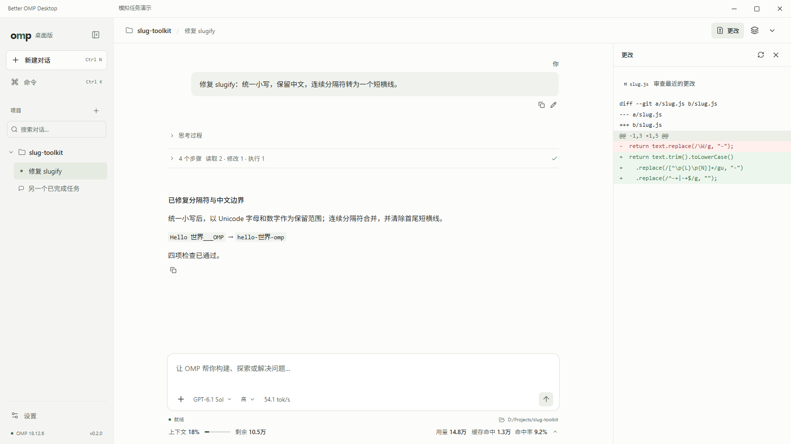

# Better OMP Desktop

基于 [Oh My Pi（OMP）](https://github.com/can1357/oh-my-pi) 的独立桌面客户端，使用 Tauri、React 和 Rust。

桌面宿主管理项目、会话、数据位置与运行时；代理能力由随安装包内置的 OMP 提供。上游提交、协议版本与本地补丁由 [upstream.lock.json](upstream.lock.json) 锁定。

## 界面预览

模拟任务：修复 `slugify`，统一小写、保留中文、合并连续分隔符，再检查边界案例。例如将 `Hello 世界___OMP` 转为 `hello-世界-omp`。以下为实际界面中的演示任务和用量数据，截图原始尺寸均为 **1600×900**。

对话主轴将项目与会话放在左侧，答复居中；模型、思考程度、原生速率与用量靠近输入区。



连续动作收为一行步骤摘要，点击读取、修改或命令可展开详情；差异和原始输出按需显示。



需要审阅时打开右侧改动面板，同时保留对话与输入区。



## 安装

在本仓库 [Releases](https://github.com/GuraQwQ/omp-better-desktop/releases) 下载 Windows x64 发行包及 `SHA256SUMS`，用 PowerShell 核对：

```powershell
Get-FileHash -LiteralPath './Better-OMP-Desktop_0.2.2_windows-x64.exe' -Algorithm SHA256
```

文件名以实际附件为准。安装器未签名，Windows 可能提示发布者未知。安装包内置匹配的 OMP；需要系统已有 WebView2，或自行提供解压到其他盘的 Fixed Version WebView2。首次启动选择数据目录，应用数据与安装目录分开管理。详见 [安装、迁移与恢复](docs/install.md) 和 [0.2.2 更新说明](docs/releases/0.2.2.md)。

## 当前范围

- 项目与会话导航、流式消息、模型选择、设置、提供商登录、文件与差异查看。
- 自定义 OpenAI / Anthropic 兼容提供商，自动获取常见模型目录并一键填入当前分组；配置保存到 OMP 原生文件，新连接的会话生效。
- 按标题、项目、路径和 ID 搜索对话；从用户消息创建编辑分支，失败回合使用 OMP 原生重试。
- 队列消息可取回草稿及附件；输入 `@` 搜索项目中的 Git 文件列表，使用方向键与 Enter/Tab 插入路径。
- 审阅面板可按用户回合查看已记录的文件工具操作，工作区 Git 差异单独查看。
- 工具步骤以轻量摘要呈现；读取、修改与命令整行可展开路径、行号、差异和退出状态，保留原始输出，重内容按需挂载。
- 显示上下文剩余、累计用量、缓存命中和 OMP 原生平滑生成速率；活跃工具行共享实时速率，统计详情可展开查看。
- OMP 运行时随包交付，首次启动校验并激活；保留上一份托管运行时用于回退。
- 原生命令与 RPC 按实际语义接入；依赖 OMP TUI 的交互通过内嵌终端接管当前会话。
- 导入既有 OMP 数据时复制源数据并记录进度；会话、凭据、配置和应用文件分别保留。

完整能力清单见 [上游集成与限制](docs/upstream.md) 和自动生成的 [功能目录](docs/feature-map.md)。第三方自定义 TUI、外部服务和语音设备的行为取决于 OMP 及相应服务，不能把目录中的条目数视作端到端验证结果。当前构建与发行流程覆盖 Windows x64。

## 从源码构建

需要 Git、Bun 1.4 或更新版本、Rust stable 的 MSVC 工具链、Visual Studio C++ Build Tools（MSVC x64/x86 与 Windows SDK）、Node.js 22 和 Python 3.12。工具链按各自官方方式安装；本项目脚本只发现和使用它们，不自动安装。

在可写的非系统盘克隆项目后：

```powershell
git clone https://github.com/GuraQwQ/omp-better-desktop.git
cd omp-better-desktop
$env:BUN_INSTALL_CACHE_DIR = Join-Path $PWD '.cache/bun'
bun install --frozen-lockfile
bun run build:runtime
./scripts/dev.ps1
```

`build:runtime` 从锁定提交创建隔离的上游 checkout，应用补丁、生成协议、编译运行时并进行无模型调用的 RPC 烟测，最后执行桌面类型与 Rust 编译检查。需要网络访问上游和依赖仓库。使用已在其他位置安装的工具链时，保留 `CARGO_HOME`、`RUSTUP_HOME` 与 PATH；也可通过 `MSVC_ROOT`、`WINDOWS_SDK_ROOT`、`WINDOWS_SDK_VERSION` 指定工具目录。

```powershell
bun run check
./scripts/dev.ps1 desktop build --bundles nsis  # 使用已经构建的运行时
bun run build:desktop                         # 重建运行时和安装器
bun run clean                                 # 清理本仓库 .cache、build、dist
```

运行时包输出到 `artifacts/runtime-windows-x64`；默认安装器输出到 `build/desktop-msvc/release/bundle/nsis`。`OMP_DESKTOP_CACHE` 和 `CARGO_TARGET_DIR` 可以覆盖缓存及构建目录，外部共享目录由设置它们的维护者清理。`clean` 保留 `.local-data`、发行运行时与依赖安装目录。

## 参与和发行

请先阅读 [贡献说明](CONTRIBUTING.md)。报告问题时附上应用版本、OMP revision、Windows/WebView2 版本、复现步骤和脱敏日志；不要上传凭据或完整私人会话。

公开 CI 执行类型检查、Rust 格式与编译检查，以及无模型调用的运行时协议烟测。定时上游 Release 更新提出 PR 后，在云端构建匹配的 Windows 安装包；检查通过且无冲突时自动合并，并将预构建包发布为预览 Release。维护者也可按正式或预览标签创建发行草稿。详见 [发行流程](docs/releasing.md)。

## 许可与来源

本项目原创代码使用 [MIT 许可证](LICENSE)。OMP、vendored Rust RPC 客户端及参考 GUI 的归属见 [第三方说明](THIRD-PARTY-NOTICES.md)。运行时包继续包含上游许可证与完整第三方 notices；各依赖保留各自许可证。
